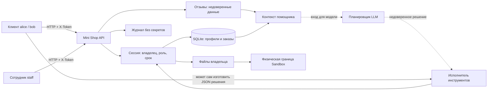

# Модель угроз Mini Shop

Дата проверки: 2 ноября 2026 года. Объект — собственный процесс из `lab/service.py`,
привязанный к `127.0.0.1`, SQLite в памяти и одноразовый каталог `Sandbox`.
Все профили, пароли, заказы и файлы учебные. Внешние адреса не проверялись.

## Система и границы доверия

Пунктир показывает отдельный модельный эксперимент: контекст передаётся модели,
а её JSON затем проверяется исполнителем. Планировщик не является источником прав.

Границы: HTTP → сервер; клиентская идентичность → серверная сессия;
клиент → чужие объекты; клиент → сотрудник; путь клиента → каталог владельца;
отзыв/вопрос → инструкции модели; решение модели → инструмент;
весь стенд → файловая система машины. Последнюю границу обеспечивает неизменённый
`sandbox.py`; он не заменяет проверку прав внутри стенда.

## Активы и политика доступа после исправлений

| Актив/операция | Анонимный посетитель | Клиент | Сотрудник |
|---|---|---|---|
| Health, каталог, экранированные отзывы | Чтение | Чтение | Чтение |
| Вход | По учебным реквизитам | По учебным реквизитам | По учебным реквизитам |
| Профиль, поиск профилей, список заказов | Запрет | Только свои | Все учебные записи |
| Создание заказа | Запрет | На своё имя, цена каталога | На своё имя, цена каталога |
| Добавление отзыва | Запрет | Разрешено для товара каталога | Разрешено для товара каталога |
| Файлы и read_file | Запрет | Только внутри своего физического каталога | Тот же принцип; каталог staff не создаётся |
| Контекст помощника | Запрет | Только свой заказ | Любой заказ; доступ к файлам отдельно ограничен |
| export_profiles и /admin/export | Запрет | Запрет | Разрешено по сессии |
| /debug/logs | Запрет | Запрет | Только очищенные записи |
| delete_tree | Запрет | Запрет | Запрет |
| Служебная заметка | Запрет | Запрет | Через API не выдаётся |

## Угрозы STRIDE

| Категория | Сценарий и актив | Находка | Защита и проверка |
|---|---|---|---|
| Spoofing | Подмена X-Role ради экспорта | F03 | Роль только из сессии; два варианта forged role |
| Tampering | SQL меняет смысл фильтра профиля/заказа | F02 | Параметры SQL, числовые ID; три SQL-проверки |
| Tampering | Цена -1 вместо 5000 | F05 | Цена из каталога, контроль созданного заказа |
| Tampering | Отзыв содержит HTML/инструкцию | F06, F09 | HTML escaping, CSP; маркировка недоверенных данных и отдельный контроль инструментов |
| Repudiation | Журнал не даёт надёжной истории и содержит секреты | F07, F11 | Минимальный ограниченный журнал; полноценный аудит остаётся вне лаборатории |
| Information disclosure | Чужие профили, заказы, чеки, заметка | F01, F04, F07, F08 | Сессия, владелец, канонический путь, роль; HTTP-матрица |
| Denial of service | Удаление всего каталога стенда | F08 | delete_tree запрещён для всех ролей; проверка сохранности файлов |
| Denial of service | Большие/неверные входы, рост журнала и сессий | F10, F11 | Типы, размеры, тайм-аут чтения, ограниченные коллекции и срок сессии |
| Denial of service | Сохранённый одиночный суррогат ломает HTML отзывов | F12 | Проверка UTF-8 до сохранения; тест отказа на исходнике и успешного ответа после исправления |
| Elevation of privilege | Клиент или модель вызывает административный инструмент | F03, F08, F09 | Проверка прав при каждом исполнении; решение не создаёт полномочий |

## Приоритеты и остаточные риски

Вначале закрываются чтение чужих данных, обход роли, SQL и исполнение инструментов;
затем цена, HTML, журнал и обработка входов. Проверяемый инвариант: даже полностью
подчинённая атакующему модель не может дать клиенту экспорт, чужой файл или удаление.

Сервис остаётся учебным: известные пароли хранятся в исходниках, отсутствуют
постоянное хранилище, промышленная защита от перебора и исчерпания потоков,
неизменяемый аудит, TLS, управление отзывом сессий. Общие данные SQLite могут расти
при большом числе покупок. Привязка к loopback сохранена; публиковать этот сервер
как промышленный магазин нельзя считать проверенным сценарием.
